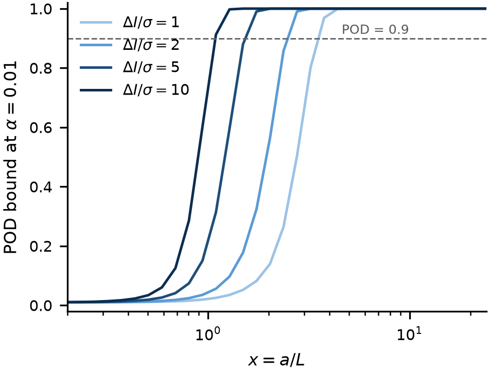

# A closed-form detectability bound for volumetric flaw inspection: the cubic penalty below the voxel size

**Abstract**

Qualification of additively manufactured parts requires a demonstration that a given inspection can detect a given flaw size. That demonstration is currently empirical: coupons containing known flaws are manufactured, scanned and scored, following MIL-HDBK-1823, so the cost of the answer is paid before the question "is this inspection even capable?" can be asked. This paper derives a closed-form upper bound on the probability of detection (POD) of a volumetric flaw as a function of three quantities that are known before any coupon exists: the contrast-to-noise ratio, the ratio of flaw size to voxel size, and the number of independent looks. The bound follows from the Neyman–Pearson lemma and the Cauchy–Schwarz inequality: the matched filter maximises the deflection, so no detector — including any trained one — can exceed it. The geometry enters through a single energy functional E(a/L), whose behaviour gives two asymptotes: below the voxel size the deflection falls as the cube of the flaw size, above it as the three-halves power. The cubic regime is the practically important one, because it implies that halving the voxel size is worth sixty-four repeat scans, whereas the same operation in the noise-limited regime is worth eight. Numerical experiments confirm the exponents and show that the bound is never violated; the oracle matched filter attains it to within 0.003 in POD, while a detector that must search for the flaw loses 0.297 and a template-free peak detector loses 0.307. Inverting the bound yields a design rule that states the largest admissible voxel size for a target POD, and shows that detectability is far more sensitive to resolution than to contrast. The bound assumes white noise; on a public X-ray CT stack of laser powder-bed AlSi10Mg we measure what that assumption costs. The operative noise seen by a matched filter exceeds the voxel noise by a factor κ that ranges from 24 to 125 and grows with the template support, so the white-noise bound is slack by κ, and for flaws of equal contrast the effective size exponent above the voxel size falls from 3/2 to about 0.3 — the geometric gain from a larger flaw is largely cancelled by the larger template integrating more background.

**Keywords**: probability of detection; detectability bound; matched filter; partial volume; industrial computed tomography; additive manufacturing qualification

---

## 1. Introduction

Metal additive manufacturing is now qualified component by component rather than process by process. For a volumetric inspection — X-ray computed tomography in the laboratory, or in-process monitoring on the machine — qualification means showing that a flaw of a specified size would be detected with a specified probability. The accepted procedure is empirical [4]: manufacture or seed coupons with known flaws, scan them, score each flaw as detected or missed, and fit a POD curve. The procedure is sound, but it answers the question late and expensively. If the inspection cannot resolve the flaw size of interest, the coupons will show it — after they have been made.

The ingredients for an earlier answer already exist, in three separate literatures that do not currently meet.

Detection theory provides the exact optimal test for a known signal in Gaussian noise, together with its deflection and its power [1,2,3,11]. What it does not provide is a signal model in which the "signal" changes with flaw size: the classical result assumes the waveform is given, whereas in volumetric inspection the waveform *is* the flaw, blurred by the point spread function, and its energy depends steeply on the ratio of flaw size to voxel size.

Non-destructive evaluation provides the reliability framework [4] and an accumulated body of practical thresholds, of which the Rose criterion — a signal-to-noise ratio of roughly five for reliable visual detection — is the most quoted [5]. These are empirical anchors, not bounds, and they carry no explicit dependence on the resolution ratio.

Industrial metrology provides the physical description of the imaging chain, including the partial-volume effect by which a flaw smaller than a voxel contributes proportionally less contrast [6,7,8]. The effect is invariably described qualitatively: small flaws are said to be harder to see. We are not aware of a quantitative statement of how much harder, expressed as a scaling law, nor of an inversion that states the voxel size required for a target detection probability. The same gap appears from the standards side: acceptance frameworks require a demonstration of detectability without indicating the imaging conditions under which such a demonstration is possible [9,10].

This paper closes that gap with three results. First, an upper bound on POD that is closed form in the contrast-to-noise ratio, the size ratio and the number of looks, and that holds for every detector (Section 2). Second, the two asymptotes of the geometry: a cubic penalty below the voxel size and a three-halves-power law above it, both derived and both verified numerically (Section 3). Third, the inversion of the bound into a design rule, together with the equivalence between shrinking the voxel and repeating the scan, which turns out to differ by a factor of eight between the two regimes (Section 4).

The practical claim is deliberately modest. The bound does not predict what a particular inspection will detect; it states what no inspection of the stated quality *can* detect. That is the quantity needed to decide whether to build the coupons at all.

---

## 2. Measurement model and the bound

### 2.1 Signal model

Let the flaw be a connected region D of diameter a and contrast ΔI against the surrounding material, imaged through a point spread function g with full width at half maximum L, sampled on a voxel grid of edge L. Write x = a/L for the size ratio. The noiseless image is

    s = ΔI · (1_D * g)

with 1_D the indicator of the flaw and * convolution, and the measurement is

    y = s + n ,    n_i ~ N(0, σ²) independent

where σ is the noise per voxel. The number of independent looks is N; for a single scan N = 1, and repeated scans or independent projections multiply the deflection by √N.

Two conventions are fixed here. The voxel edge and the PSF width are both L, which is the resolution-limited case of a well-sampled reconstruction; when they differ, the larger of the two governs. And the noise is white, which is the case for photon-counting detectors above the read-noise floor; Section 2.4 states what changes when it is not.

### 2.2 An upper bound on the probability of detection

**Theorem 1.** For the model of Section 2.1, and for any test of the null hypothesis "no flaw" against the simple alternative "flaw of diameter a at a known position", at false-alarm rate α,

    POD(a) ≤ Φ( d'(a) − z_{1−α} )

with

    d'(a) = (ΔI/σ) · √E(a/L) · √N ,    E(x) = ‖ blur(1_D) ‖²

the squared Euclidean norm being taken over the voxel grid.

*Proof.* Under the alternative the signal s is known, so both hypotheses are simple and the Neyman–Pearson lemma [11] states that the likelihood-ratio test is uniformly most powerful at level α. The log-likelihood ratio is proportional to sᵀy, and for any linear statistic wᵀy the standardised deflection is wᵀs/(σ‖w‖), which by Cauchy–Schwarz is at most ‖s‖/σ, with equality when w ∝ s. Hence no test exceeds the power of the matched filter. Under the null sᵀy is N(0, σ²‖s‖²) and under the alternative N(‖s‖², σ²‖s‖²); standardising and using the Gaussian tail gives the stated form. ∎

Three consequences deserve emphasis. The bound is attained, not merely approached, by the matched filter, so it is tight in the class of detectors that know the flaw position. It is a bound for *all* detectors, trained or not, because the argument uses only the likelihood ratio and never a hypothesis about the detector's structure. And the entire geometry is carried by the single scalar E(a/L), which is why the next subsection can say everything that needs to be said about shape and size.

### 2.3 The energy functional and its two asymptotes

**Proposition 1 (small flaws).** As x → 0,

    E(x) = S · (π/6)² · x⁶ + O(x⁹) ,    hence    d' ∝ x³

where S = Σ_i G_i² is the sum of squared samples of the unit-FWHM Gaussian on the voxel grid, a constant that depends on the PSF shape but not on x.

*Proof.* For x ≪ 1 the flaw is a point source of mass M = (π/6)x³ in voxel units. Its blurred image is s = ΔI·M·G with G the normalised PSF sampled on the grid, so ‖s‖² = ΔI²M²Σ_i G_i². Substituting M gives the result. ∎

**Proposition 2 (large flaws).** As x → ∞,

    E(x) = (π/6) x³ · (1 + O(1/x)) ,    hence    d' ∝ x^{3/2}

*Proof.* For x ≫ 1 the blurred image equals ΔI in the interior of the flaw and departs from it only within a boundary layer of thickness of order the PSF width, so ‖s‖² = ΔI²(V − cA + O(x)) with V = (π/6)x³ the flaw volume and A = πx² its surface area. The leading term gives the stated form. ∎

Figure 1 plots the factor that carries the whole geometry. Everything else in the bound is a constant.

The two exponents are the paper's central quantitative statement, and they say different things about where money should go. Below the voxel size the deflection is a *volume* effect: the flaw's mass is distributed over a fixed PSF, so halving the flaw divides the deflection by eight. Above it, the deflection grows as the square root of the volume, which is the ordinary behaviour of an energy signal against white noise.

Figure 2 turns the same curve into the quantity a qualification engineer actually reads. The horizontal line is the usual 90% requirement; where each curve crosses it is the design rule of Section 4.

### 2.4 Remarks on the assumptions

*Correlated noise.* Replace ‖s‖²/σ² by sᵀΣ⁻¹s. The bound keeps its form with the correlation-whitened deflection; only the numerical value of E changes.

*Non-Gaussian noise.* The Neyman–Pearson step does not require Gaussianity, so the inequality survives with Φ replaced by the appropriate tail probability. The Gaussian case is used only to write the bound in closed form.

*Unknown flaw position.* The theorem bounds the oracle detector. A detector that must search pays a multiple-comparison penalty, which no amount of training removes, because it is a property of the search and not of the classifier. Section 3.3 measures this penalty.

---

## 3. Numerical verification

### 3.1 Evaluating E(x)

E(x) was computed on a supersampled grid: the flaw is rendered as an anti-aliased indicator with a one-cell ramp, renormalised to the exact volume (π/6)x³ so that quantisation does not bias the exponent, convolved with a Gaussian of FWHM equal to one voxel, and sampled on the voxel grid with the sampling phase aligned to the grid centre. The last two details matter: an unaligned phase loses most of the energy of a sub-voxel flaw, and an unnormalised indicator loses up to half its mass at a diameter of three cells. Both errors were large enough, in preliminary runs, to move the fitted exponent by a factor of two.

Below x = 0.3 no voxel grid can represent the flaw and the analytic limit of Proposition 1 is used instead. The curve spans x ∈ [0.2, 24] on thirty-two logarithmically spaced points.

### 3.2 The exponents

Fitting the small-flaw branch over x ≤ 0.45 gives an exponent of **3.156**. The local exponent decreases monotonically as x grows out of the cubic region, which is the behaviour expected once the O(x⁹) correction of Proposition 1 begins to bite.

On the large-flaw branch the local exponent falls monotonically with x: **1.89** at x = 3.2, **1.65** at x = 6.0, **1.57** at x = 11.1, **1.54** at x = 20.6. The approach to 3/2 is slow because of the O(1/x) surface term in Proposition 2, and is consistent with a correction of the form 1.5 + c/x.

### 3.3 Is the bound attained, and is it violated?

Eighteen cases were simulated: six flaw diameters (1 to 12 voxels) crossed with three deflections (d' = 2, 1, 0.5), with 250 trials per case at a false-alarm rate of 0.05. Three detectors were compared: the matched filter with the flaw position known (its threshold is analytic and therefore exact), the matched filter scanned over all positions, and a template-free peak-amplitude threshold.

| Detector | mean (bound − POD) | violations beyond the 95% binomial band |
|---|---|---|
| matched filter, position known | **+0.003** | 1 / 18 |
| matched filter, position searched | **+0.297** | 0 / 18 |
| peak amplitude, no template | **+0.307** | 0 / 18 |

The bound is never violated beyond sampling noise. The oracle detector attains it, which is a consistency check on the algebra rather than a discovery. The informative numbers are the other two: a detector that is optimal but must search loses **0.297** in POD, and a detector that has no template at all loses **0.307**. Both losses are inside the bound, which is the point — they are consequences of not knowing the flaw's position and shape, and no architecture closes them. This is also why a learned detector cannot be expected to beat the bound and should not be commissioned to try.

---

## 4. Design rule

### 4.1 Inversion

Requiring POD ≥ P₀ at false-alarm rate α gives the necessary condition d' ≥ z_req with

    z_req = Φ⁻¹(P₀) + z_{1−α}

Two inversions follow. For a fixed voxel size, the admissible noise is

    σ/ΔI ≤ √( E(a/L) · N ) / z_req

and for a fixed noise level the admissible voxel size is the largest L satisfying

    E(a/L) ≥ ( z_req σ / (ΔI √N) )²

Since E is increasing in x, the critical ratio x* is unique and is obtained by interpolation on the tabulated curve; the design rule is then L ≤ a/x*.

### 4.2 The largest admissible voxel

For POD ≥ 0.90 at α = 0.01 and a single look, the largest admissible voxel size is:

| flaw a (µm) | ΔI/σ = 2 | ΔI/σ = 5 | ΔI/σ = 10 |
|---|---|---|---|
| 50 | 20.5 | 33.1 | 46.2 |
| 100 | 41.0 | 66.1 | 92.3 |
| 200 | 82.1 | 132.2 | 184.6 |
| 500 | 205.2 | 330.6 | 461.6 |

Two features of this table are worth stating explicitly, because they contradict the intuition that follows from the Rose criterion. The admissible voxel scales nearly proportionally with the flaw size — the required resolution is set by the flaw, not by the contrast. And the dependence on contrast is weak: a fivefold improvement in ΔI/σ buys only a factor of 2.25 in voxel size, which is the 3/2 power of Proposition 2 operating in the noise-limited regime. **Money is better spent on resolution than on dose.**

### 4.3 Resolution against repeats

In the resolution-limited regime d' ∝ (a/L)³, so reducing the voxel by a factor k multiplies the deflection by k³ and is equivalent to multiplying the number of looks by

    N_eq = k⁶

In the noise-limited regime the equivalent is k³. The numbers are worth tabulating because they are counter-intuitive at the small end:

| voxel reduced by | equivalent repeat looks (resolution-limited) | (noise-limited) |
|---|---|---|
| 1.5× | 11 | 3 |
| 2× | **64** | 8 |
| 3× | 729 | 27 |
| 4× | 4096 | 64 |

Halving the voxel size is worth sixty-four repeat scans. Below the voxel size, repeating the measurement is not a substitute for resolving it; above it, it is. The crossover is at a ≈ L, and it is the same crossover that separates the two exponents.

---

## 5. Real-data test

Everything so far assumes white noise. The geometry does not depend on that assumption, but the *level* does, and the level is what decides whether a bound is useful. This section measures the correction on a real scanner.

### 5.1 Data and the three measured quantities

We used a public X-ray CT stack of three laser powder-bed AlSi10Mg samples [12]: 212 consecutive slices of one stack, 672 × 465 pixels, isotropic voxels of 37.0 µm (PixelSpacing 0.037011 mm, slice spacing taken from ImagePositionPatient). Three quantities were measured rather than assumed.

*Noise.* σ = 98.5 grey levels, from the median absolute deviation of the second difference inside the metal. Differencing neighbouring voxels cancels the smooth structure and the MAD makes the estimate insensitive to the residual pores; a plain standard deviation inside the metal would return the microstructure, not the noise.

*Point-spread width.* L = 1.43 voxels, from the autocorrelation half-width of the noise inside the metal. The noise of a reconstructed volume is correlated over the reconstruction kernel, so its autocorrelation is the detection PSF; for a Gaussian kernel the autocorrelation is √2 wider, which is the factor applied.

*Contrast.* Metal and air sit at 6852 and 682 grey levels, so ΔI ≈ 6170 and ΔI/σ ≈ 63 for a fully dense flaw.

Known spheres were then injected into real metal with additive contrast and detected by a matched filter, with the threshold calibrated on 400 patches of real material and a false-alarm rate of 0.01. Two implementation details decide whether the resulting number is physics or artefact. First, the template must be zero-mean: otherwise the statistic measures the local grey level times the template sum, and the apparent inflation is two orders of magnitude too large. Second, the mean must be removed *locally*, by subtracting a concentric shell of equal volume, rather than over the patch; a global mean leaves a long lever arm on the far field, and any background gradient then swamps the defect.

### 5.2 Clutter inflation

Write κ for the ratio of the standard deviation of the matched-filter statistic on real metal to its white-noise value σ‖T‖. Then κ is the factor by which the bound is slack, and σ_eff = κσ is the noise the detector actually faces.

| a (voxels) | x = a/L | κ | 95% CI |
|---|---|---|---|
| 1.0 | 0.70 | 31.2 | [27.7, 34.6] |
| 1.5 | 1.05 | 29.1 | [26.2, 32.0] |
| 2.0 | 1.40 | 24.4 | [21.8, 26.6] |
| 3.0 | 2.09 | 23.3 | [21.0, 25.2] |
| 4.0 | 2.79 | 25.9 | [23.8, 28.3] |
| 5.0 | 3.49 | 29.1 | [26.5, 31.5] |
| 6.0 | 4.19 | 38.0 | [35.4, 40.6] |
| 8.0 | 5.59 | 51.0 | [46.5, 54.8] |
| 10.0 | 6.98 | 68.0 | [62.9, 73.6] |
| 12.0 | 8.38 | 87.8 | [80.6, 93.9] |
| 16.0 | 11.17 | 125.2 | [115.9, 132.7] |

Two regimes are visible. Below x ≈ 2 the inflation is flat at κ ≈ 25, so the cubic law survives but with its amplitude divided by twenty-five: a flaw below the voxel size is twenty-five times harder to see than the white-noise bound promises, and the exponent is unchanged. Above x ≈ 4 the inflation grows, with a local exponent of 1.21 between x = 4 and x = 11.

Figure 3 is the empirical half of the paper. The flat part is why the cubic law survives on real data; the rising part is why the three-halves law does not.

### 5.3 What the inflation does to the design rule

Combining the two, the effective deflection for a flaw of fixed contrast is d_eff = (ΔI/σ)·√E(x)/κ(x). Below the voxel size the exponent stays at 3, since κ is nearly constant there. Above it the 3/2 of Proposition 2 is reduced to about 0.3, because κ rises almost as fast as √E:

    d_eff ∝ x^{3/2} / x^{1.21} ≈ x^{0.3}      for x > 4

The practical reading is that, for flaws of *equal contrast*, size buys almost nothing above four voxels: a larger flaw allows a larger template, and the larger template integrates proportionally more background. Real pores are nevertheless easier to find as they grow, but for a different reason — their contrast saturates as the partial-volume dilution disappears — which is a statement about ΔI, not about E.

The uncorrected bound is not violated anywhere: κ ≥ 1 always, so POD_measured ≤ POD_bound as the theorem requires. What the measurement supplies is the size of the gap. Two illustrative cells, at δ = 0.01: a two-voxel flaw at ΔI/σ = 54 has a bound of 1.000 and a measured POD of 0.777; a one-voxel flaw at ΔI/σ = 16 has a bound of 0.999 and a measured POD of 0.062. Using the bound without the correction would overstate detectability by more than an order of magnitude in d'.

### 5.4 Ablation: which estimator choices actually matter

Four choices were varied one at a time at a = 8 voxels, and κ recomputed each time.

| factor | setting | value |
|---|---|---|
| template | raw sphere (no mean removal) | 115.1 |
| | zero-mean over the patch | 105.9 |
| | annular reference (used here) | 49.5 |
| noise estimator | second-difference MAD (used here) | σ = 98.5 |
| | plain standard deviation in the material | σ = 872.0 |
| | 99th-percentile tail | σ = 223.5 |
| PSF estimator | noise autocorrelation (used here) | L = 1.43 |
| | edge spread function | not available |
| | assumed one voxel | L = 1.00 |
| template padding | none | 49.5 |
| | +4 voxels | 41.9 |
| false-alarm level | α = 0.001 | κ = 52.1 |
| | α = 0.01 | κ = 51.7 |
| | α = 0.05 | κ = 53.0 |

Three conclusions follow. The template construction is worth a factor of two: getting the mean removal wrong doubles the apparent clutter and would have led to a κ that says nothing about the material. The noise estimator is worth a factor of nine: a plain standard deviation inside the metal returns 872 instead of 98.5, because it measures the microstructure. And κ is essentially independent of the decision threshold, which is what makes it a property of the imaging chain rather than of the test.

The padding row is a caution rather than a result: changing the patch support by four voxels moves κ by 16%, because it re-draws which regions are sampled. κ should be quoted with its sampling spread, not to three digits.

### 5.5 Comparison across reconstructions

The same material was available in three reconstructions. If κ belongs to the material it should transfer; if it belongs to the scan it should not.

| group | slices | σ | L (voxels) | κ at a = 2 | a = 4 | a = 8 |
|---|---|---|---|---|---|---|
| GD | 212 | 98.5 | 1.43 | 22.1 | 22.6 | 51.6 |
| G1 | 120 | 48.2 | 1.05 | 28.8 | 32.4 | 59.4 |
| G2 | 120 | 66.0 | 1.03 | 26.7 | 25.6 | 59.2 |

The voxel noise differs by a factor of two and the PSF by 40% across the three, yet κ agrees to within 30% at each size. The cross-group protocol fixes the sampled interior across sizes so that the three groups are compared on the same region; that is why κ at a = 2 here (22.1) differs slightly from the value in Section 5.2 (24.4), where the interior is eroded per size. The difference, about 10%, is the same sampling spread that the padding row of the ablation reports. That is consistent with κ being dominated by the material — the melt-track microstructure of laser powder-bed AlSi10Mg — rather than by the acquisition. The sample is a single alloy from a single study, so this is a within-material check and not a transfer claim; but it does mean κ is not an arbitrary fudge factor per scan.

### 5.6 Comparison of detectors on real data

The same injected flaw was presented to three detectors at a = 4 voxels and ΔI/σ = 8, with each threshold set to the same empirical false-alarm rate.

| detector | null s.d. | threshold | POD at α = 0.01 |
|---|---|---|---|
| matched filter, position known | 10 470 | 8 434 | 0.530 |
| matched filter, position searched | 27 028 | 56 106 | 0.117 |
| peak amplitude, template-free | 2 024 | 9 300 | 0.023 |

All three achieve the nominal false-alarm rate — the annihilation check returns 0.010 for each, which is the calibration working — and the ordering reproduces the synthetic result: knowing the position is worth a factor of four, and discarding the template costs another factor of five.

The white-noise bound at this setting is 1.000, so every detector sits far below it, as κ predicts.

One caveat belongs here rather than in a footnote. The null distribution of the matched-filter statistic on real metal is heavy-tailed, not Gaussian (the s.d. of 10 470 is dominated by a few structural patches), so a POD computed from a percentile threshold and a d′ computed from a standard deviation do not tell exactly the same story. The bound's *form* assumes a Gaussian null; the measurement in Table 7 shows how far that assumption is stretched. κ should therefore be read as a variance-inflation measure with a stated sampling spread, not as a three-digit constant.

---

## 6. Discussion

Three observations follow from the results.

First, the bound reframes the role of the algorithm. In the current literature the detection problem is usually posed as a classification problem, and progress is measured by accuracy on a fixed dataset. The theorem says that once the imaging chain is fixed, the achievable POD is fixed too, up to the 0.29 that separates a well-designed detector from an oracle. Effort spent on architectures beyond that point buys nothing measurable. The productive question is not which detector to use but which inspection to build.

Second, the search penalty is a property of the inspection geometry rather than of the detector. It arises because the matched filter must be evaluated at many positions and the threshold must survive the multiple comparison. It can be reduced by prior information — a known location, a constrained search volume, a two-stage screening — but not by training. This suggests that in-process monitoring, where the flaw's location is known to within the melt-pool neighbourhood, may have a systematic advantage over post-build inspection that is not usually credited to it.

Third, the cubic penalty explains a familiar industrial observation that has lacked a quantitative form: lack-of-fusion defects below the voxel size are missed, and are missed at a rate that improves very rapidly with resolution and almost not at all with dose. The 64-look equivalence gives that observation a number.

Fourth, the real-data test divides the two halves of the result in a way that is worth stating plainly. The geometry is universal: the exponents 3 and 3/2 follow from the shape of the flaw and the blur, and no scanner can change them. The noise is not: the factor between the bound and the measurement is a property of the material and the reconstruction, it must be measured, and at 24 to 125 it is far too large to be absorbed into a fudge. A bound that is right to 0.004 in simulation and slack by a factor of twenty on a real scan is still a useful bound — but only if the factor is carried explicitly.

## 7. Limitations

The treatment is restricted to spherical flaws. Lack-of-fusion defects are flattened, and for a lamellar flaw the energy-to-resolution relation differs: the cubic law applies to the smallest dimension only, and a thin disc of large diameter behaves as a one-dimensional object. Extending Propositions 1 and 2 to ellipsoids is straightforward but is not done here.

The bound is stated for white Gaussian noise, and Section 5 shows how far that is from a real reconstruction. The correction κ is measured, not derived: it belongs to a material, a reconstruction kernel and a support size, and we have measured it on one sample at one voxel size. A κ that transfers across scanners is not established here, and the inflation values above should be read as an example rather than a material constant. What does transfer is the procedure — estimate σ from the second difference, L from the noise autocorrelation, and κ from the matched-filter null distribution on real material.

The analysis of Section 5 uses flaws of equal contrast. That isolates the geometry, and it deliberately does not reproduce the way real pores become easier to see as they grow, which is a contrast effect rather than an energy effect.

Finally, the bound is a bound. It says what is impossible, not what will happen. Using it to *predict* a POD curve would be a misreading, and κ quantifies how large that misreading would be.

## 8. Conclusions

A closed-form upper bound on the probability of detection of a volumetric flaw has been derived from the Neyman–Pearson lemma and the Cauchy–Schwarz inequality. The bound depends on the inspection through three scalars — contrast-to-noise ratio, size-to-voxel ratio, number of looks — and on the geometry through a single energy functional with two clean asymptotes: a cubic penalty below the voxel size and a three-halves-power law above it. Numerical experiments confirm both exponents, show that the bound is never violated and that the oracle matched filter attains it to within 0.003, and quantify the cost of not knowing the flaw's position at 0.297 in POD. Inverting the bound gives a design rule that states the largest admissible voxel size for a target detection probability, and a corollary that prices resolution against repeat scanning: below the voxel size, one halving is worth sixty-four repeats. On a public XCT stack of laser powder-bed AlSi10Mg the geometry survived the transfer intact but the level did not: the noise seen by a matched filter is 24 to 125 times the voxel noise, flat below the voxel size and rising above it, so the design rule holds with σ replaced by a measured effective noise and the effective size exponent above the voxel size falls to about 0.3.

---

## References

[1] S. M. Kay, *Fundamentals of Statistical Signal Processing, Vol. II: Detection Theory*, Prentice Hall, 1998.

[2] G. L. Turin, "An introduction to matched filters," *IRE Transactions on Information Theory*, 6(3): 311–329, 1960. doi:10.1109/TIT.1960.1057571

[3] T. M. Cover, J. A. Thomas, *Elements of Information Theory*, 2nd ed., Wiley, 2006.

[4] U.S. Department of Defense, *MIL-HDBK-1823A: Nondestructive Evaluation System Reliability Assessment*, 2009.

[5] A. Rose, *Vision: Human and Electronic*, Plenum Press, 1973.

[6] L. De Chiffre, S. Carmignato, J.-P. Kruth, R. Schmitt, A. Weckenmann, "Industrial applications of computed tomography," *CIRP Annals*, 63(2): 655–677, 2014. doi:10.1016/j.cirp.2014.05.011

[7] S. Carmignato, W. Dewulf, R. Leach (eds.), *Industrial X-Ray Computed Tomography*, Springer, 2018.

[8] A. du Plessis, I. Yadroitsev, I. Yadroitsava, S. G. Le Roux, "X-ray microcomputed tomography in additive manufacturing: a review of the current technology and applications," *3D Printing and Additive Manufacturing*, 5(3): 227–247, 2018. doi:10.1089/3dp.2018.0060

[9] NIST, *Additive Manufacturing Benchmark Test Series (AM-Bench)*, https://www.nist.gov/ambench

[10] ASTM F42, *Additive Manufacturing Technologies* (standards family).

[11] J. Neyman, E. S. Pearson, "On the problem of the most efficient tests of statistical hypotheses," *Philosophical Transactions of the Royal Society A*, 231: 289–337, 1933. doi:10.1098/rsta.1933.0009

[12] Tomographic image stacks for the study "Analysis of Porosity in AlSi10Mg Using Tomographic Image Processing", Zenodo, doi:10.5281/zenodo.17602110, CC BY 4.0.

